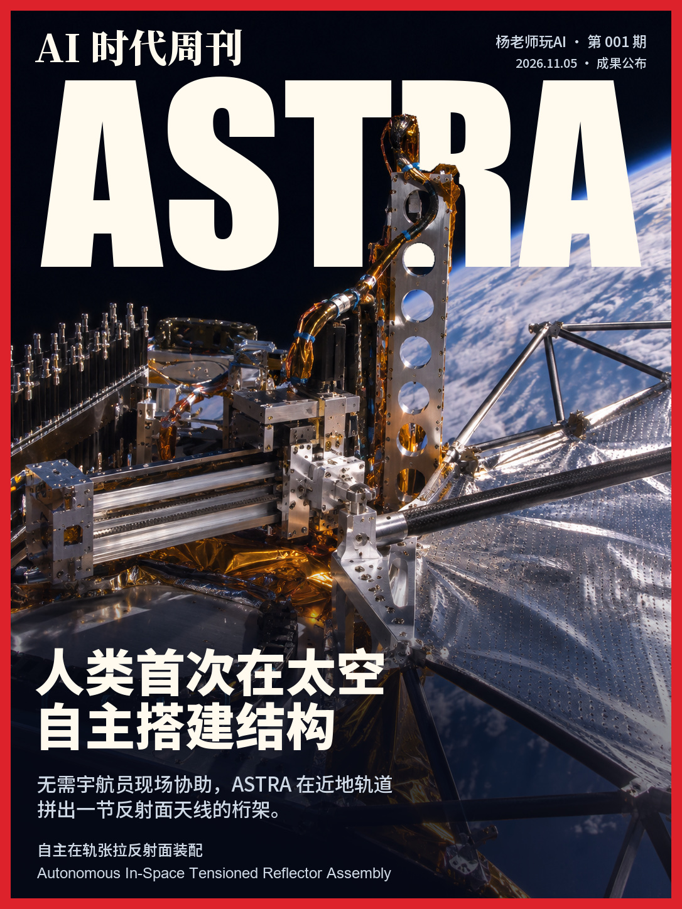

# AI 时代周刊 · 杨老师玩AI

> AI Times Weekly — one cover a week for the biggest AI story, by 杨老师玩AI.

**AI 时代周刊**是「杨老师玩AI」出品的每周 AI 热点封面。每周挑一件本周最值得记住的 AI 大事，做成一张杂志封面：时代周刊那种气质，写实摄影的质感，中英双语两个版本。

每期封面都配一份完整的创作档案：版式设计说明、中英文标题文案、可以直接拿去生图的提示词。想自己动手做同款的，照着档案就能复现。

## 最新一期 · ASTRA

<a href="issues/001-astra.md"></a>

封面为 AI 示意图。[查看中英文封面与创作档案](issues/001-astra.md)

## 发布节奏

- **每周日**发布一期
- 品牌署名统一为「**杨老师玩AI**」，加期号，例如「杨老师玩AI · 第 001 期」

## 目录结构

```
.
├── README.md            # 仓库首页（就是这一页）
└── issues/
    ├── 001-astra.md     # 第 001 期创作档案
    ├── 001-astra/       # 中英文成品封面及无字底图
    └── NNN-slug.md      # 命名规则：三位期号 + 英文短名
```

每期文件 `issues/NNN-slug.md` 包含：

1. 期号、日期、署名和中英文封面
2. 本期选题和版式设计说明
3. 中英文封面文案
4. 实际使用的 AI 图像生成提示词

## 往期列表

| 期号 | 刊期 | 选题 | 中文主标题 | English Headline | 档案 |
| --- | --- | --- | --- | --- | --- |
| 第 001 期 | 2026-11-15 | 加州理工 ASTRA 在近地轨道自主组装反射面天线桁架 | 人类首次在太空自主搭建结构 | THE FIRST STRUCTURE BUILT AUTONOMOUSLY IN SPACE | [第 001 期档案](issues/001-astra.md) |

---

杨老师玩AI · AI 时代周刊
