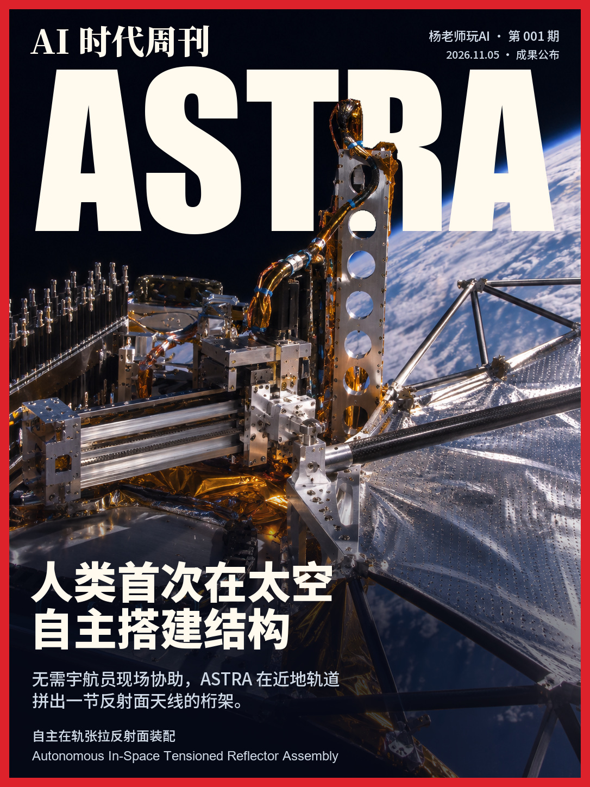
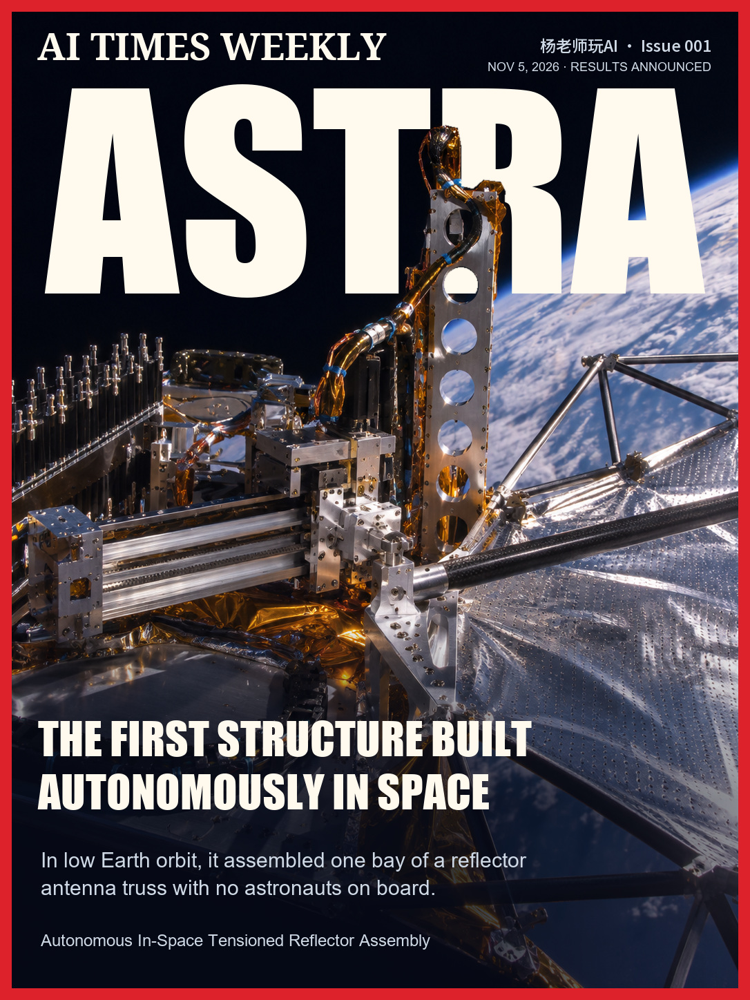

# 第 001 期 · ASTRA

**杨老师玩AI · 第 001 期** / **Issue 001**

刊期 / Issue date · 2026-11-15

成果公布 / Results announced · 2026-11-05

| 中文封面 | English cover |
| --- | --- |
|  |  |

封面是依据 ASTRA 真实硬件制作的 AI 场景复原。 Both covers share an AI-generated reconstruction based on ASTRA’s hardware.

[无字底图 / Artwork without text](001-astra/artwork.jpg)

## 本期选题 / The Story

加州理工学院的 ASTRA（Autonomous In-Space Tensioned Reflector Assembly，自主在轨张拉反射面装配）在近地轨道完成了人类首次在太空自主搭建结构。地面团队通过 Vigoride 7 下达指令并检查回传照片。ASTRA 在没有宇航员现场协助的情况下，推出两节预装桁架，再用复合材料纤维管和铝制接头在轨拼出第三节，并挂接穿孔的 Kapton 反射膜。

原型反射面天线设计直径为 1.4 米，完整桁架需要 11 节。这次新装的一节验证了把零件送上去、在轨组装的方式可行，为今后建造更大的反射面天线提供了实证。

Caltech’s ASTRA demonstrated the first autonomous assembly of a structure in space. The ground team sent commands through Vigoride 7 and checked returned images. With no astronauts on board, ASTRA deployed two preassembled truss bays and built a third in low Earth orbit from composite struts and aluminum joints, attaching a perforated Kapton reflector film.

The full 1.4-meter reflector was designed for 11 bays. Building one new bay in orbit demonstrated a way to ship parts and assemble larger structures in space.

原始报道 / Primary sources · [Caltech](https://www.caltech.edu/about/news/caltech-robotic-space-demo-successfully-builds-in-space) · [DARPA](https://www.darpa.mil/news/2026/nom4d-program-demonstrates-automated-in-space-assembly)

## 版式与封面文案 / Cover Design & Copy

红框沿着封面四边延伸，刊头直接落在深空上。ASTRA 是画面中最大的字，局部让位于前景机械结构。画面焦点是龙门式机械手把纤维管与铝制接头接合的瞬间。

| 中文 | English |
| --- | --- |
| 人类首次在太空自主搭建结构 | THE FIRST STRUCTURE BUILT AUTONOMOUSLY IN SPACE |
| 无需宇航员现场协助，ASTRA 在近地轨道拼出一节反射面天线的桁架。 | In low Earth orbit, it assembled one bay of a reflector antenna truss with no astronauts on board. |
| 自主在轨张拉反射面装配 | Autonomous In-Space Tensioned Reflector Assembly |

## 本期实际使用的提示词 / Prompt Used for This Issue

无字底图由内置 ImageGen 生成，参考 Caltech/Momentus 的[在轨顶视照片](https://caltech-prod.resources.caltech.edu/main/images/Bay3_top_camera.a3914f5d.max-1400x800.png)、[在轨近照](https://caltech-prod.resources.caltech.edu/main/images/Bay3.576e48f6.max-1400x800.png)和 Caltech 的[地面硬件照片](https://caltech-prod.resources.caltech.edu/main/images/IMG_3553.80137b26.max-1400x800.jpg)。中英文封面在同一底图上分别排版。

```text
Use case: photorealistic-natural. Create a portrait 3:4, print-magazine editorial photograph, full bleed, of the true Caltech ASTRA payload's robotic manipulator working in low Earth orbit. A striking visual about the first robotically assembled structure in space: a compact open three-axis linear gantry connects one slim graphite composite strut to a machined aluminum corner node on its assembly plate. This as-yet incomplete reflector has a few adjoining triangulated perimeter truss sections and a taut silvery perforated film trailing away, no closed ring or full dish. Reference 1: ASTRA's actual top camera for the shape and in-orbit lighting. Reference 2: an actual onboard photograph for gold Kapton blanket, silver film and real flight hardware finishes. Reference 3: the Caltech lab photo for the real orthogonal silver rails and rectangular upright with circular lightening holes, small linear carriage, black cable chain and tube rack. Apply only the equipment cues; exclude people and labs.
Signed visual composition: the top 9% a naturally dark open sky for an added masthead. The recognizably machine-like tall punched aluminum rail and one small gold edge of the gantry reach up into the upper-middle sky (around x=56–71%, y=17–39% measured from top). In this upper area leave uncluttered sky on both sides of the rail so it can overlap a few large type letters later. Below it, the actual equipment spreads across the center of the cover in the y=32–74% band; it is the large cinematic hero, never a tiny object. Looking from a slightly raised, oblique orbital camera, focus on the meeting point of carbon-fiber tube and silver socket at x=53%, y=53%, bridge rail to its left and perforated silver membrane to its right. An edge of cloud-wrapped real Earth sweeps diagonally up the right quarter behind the truss, with a thin cobalt atmosphere. Bottom 25% consists of real deep-navy space and dark spacecraft shadow, darkest near lower left for later title and captions. Strong but believable single hard sun from upper right, with a deliberate bright edge on cold brushed silver and an amber glint caught in gold thermal blanket near the joint. Low-saturation blue, silver, black and very restrained gold. Medium-format on-orbit documentary photo feeling, real textures and sharp working foreground; elegant, high-contrast newsweekly cover composition. No text, logos, letters, graphics, typography, numeric marks, frames, watermark, starscape, suns in frame, welding, sparks, glowing machinery, robotic fingers, humanoid, jointed industrial arm, astronauts, or sci-fi hardware.
```
